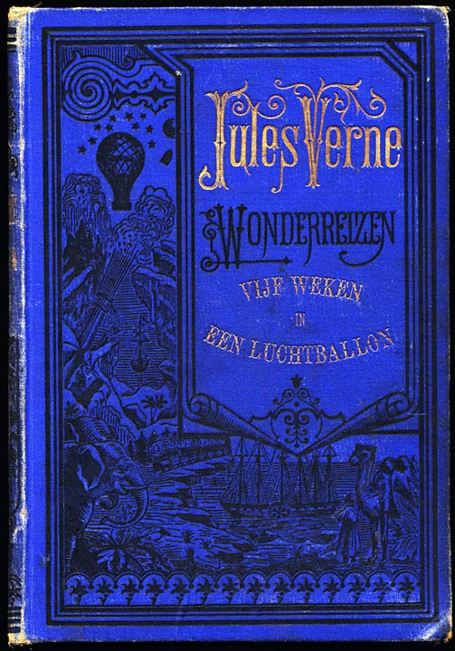

= Over dit archief

Dit archief bevat het TEI-bronbestand, evenals afgeleide tekst- en HTML-bestanden van een eboek dat is gepubliceerd door https://www.gutenberg.org/[Project Gutenberg]. Net als de versie die op Project Gutenberg is gepubliceerd, is dit eboek vrij van auteursrechten in de Verenigde Staten. Er wordt geen uitspraak gedaan over de auteursrechtelijke status buiten de Verenigde Staten.

De versie die in dit archief wordt onderhouden, kan enigszins afwijken van de versie die bij Project Gutenberg wordt beheerd. Meestal worden correcties eerst hier aangebracht en pas daarna opnieuw op Project Gutenberg geplaatst. Wanneer je een probleem tegenkomt in deze tekst, meld het dan hier.

== Over dit eboek

[cols="1,3"]
|===
|Veld |Waarde

|Titel |Vijf weken in een luchtballon
|Uniforme titel |Cinq semaines en ballon, Dutch
|Auteur |Jules Verne (1828–1905)
|Uitgever |Project Gutenberg, Urbana, Illinois, USA., 2006-08-20
|Uitgiftedatum |2006-08-20
|Beschikbaarheid |Dit eBoek is voor kosteloos gebruik door iedereen overal, met vrijwel geen beperkingen van welke soort dan ook. U mag het kopiëren, weggeven of hergebruiken onder de voorwaarden van de Project Gutenberg Licentie in dit eBoek of on-line op https://www.gutenberg.org/[www.gutenberg.org]. This eBook is for the use of anyone anywhere at no cost and with almost no restrictions whatsoever. You may copy it, give it away or re-use it under the terms of the Project Gutenberg License included with this eBook or online at https://www.gutenberg.org/[www.gutenberg.org]. Vertaling van https://www.gutenberg.org/ebooks/4548[Cinq semaines en ballon] (1863). Een Engelse vertaling is beschikbaar als https://www.gutenberg.org/ebooks/3526[Five Weeks in a Balloon]; een Finse vertaling als https://www.gutenberg.org/ebooks/49189[Viisi viikkoa ilmapallossa].
|Aantal woorden |79997 (ongeveer 276 bladzijden) 
|Trefwoord |Science fiction
|Trefwoord |Africa -- Fiction
|Trefwoord |Adventure stories
|Trefwoord |Balloons -- Fiction
|Trefwoord |Voyages and travels -- Fiction
|PG eboeknummer |https://www.gutenberg.org/ebooks/19086[19086]
|QR-code voor download a|image::Processed/images@1/qr19086.png[QR code,148,148]
|ISBN |979-8-238-19086-0
|===
